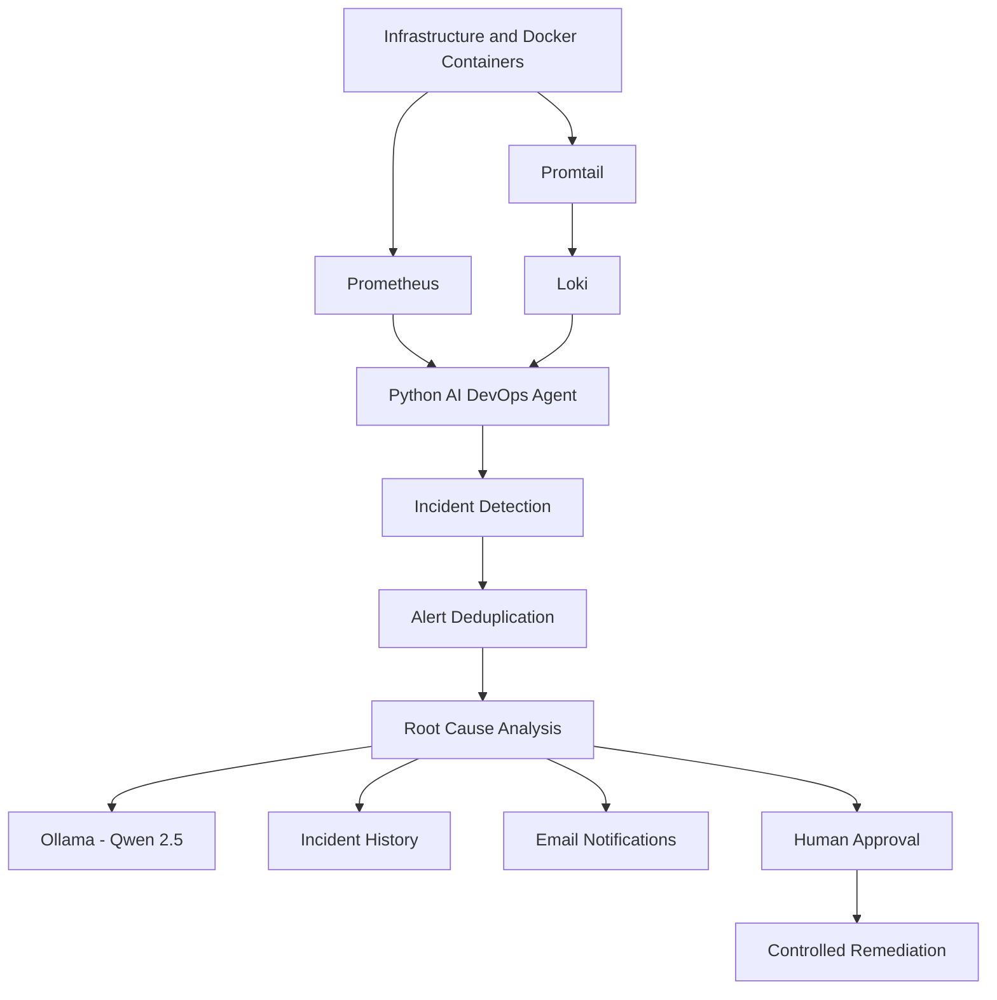

# AI DevOps Agent – Intelligent Infrastructure Monitoring and Root Cause Analysis

An AI-assisted DevOps monitoring and incident analysis system that combines infrastructure monitoring, log analysis, incident detection, AI-powered Root Cause Analysis (RCA), email notifications, and human-approved remediation.

The goal of this project is to reduce manual troubleshooting effort by combining traditional monitoring tools with an AI agent.

## Project Overview

The AI DevOps Agent collects infrastructure metrics and application logs, detects potential incidents, analyzes the available evidence, and provides troubleshooting recommendations.

It uses Python for monitoring and incident processing, Prometheus and Loki for observability, and Ollama with Qwen 2.5 for AI-assisted analysis.

## Architecture



## Key Features

- **Infrastructure Monitoring:** Collects system metrics such as CPU, memory, disk usage, and load.
- **Prometheus Integration:** Retrieves monitoring metrics for infrastructure health checks.
- **Docker Monitoring:** Uses cAdvisor and Node Exporter to collect container and host metrics.
- **Centralized Log Monitoring:** Uses Promtail and Loki to collect and query container logs.
- **Incident Detection:** Identifies potential infrastructure and application issues.
- **Alert Deduplication:** Helps prevent repeated notifications for the same incident.
- **AI-Assisted Root Cause Analysis:** Uses Ollama and Qwen 2.5 to explain incident evidence and possible causes.
- **Email Notifications:** Sends incident notifications through SMTP.
- **Incident History:** Stores and retrieves previously detected incidents.
- **Human Approval Workflow:** Provides an approval step before controlled remediation.
- **Controlled Remediation:** Supports a human-approved approach to executing remediation actions.

## AI Agent Workflow Chart


          AI DEVOPS AGENT WORKFLOW
                     |
                     v
          Applications and Servers
                     |
                     v
              Docker Containers
                     |
          +----------+----------+
          |                     |
          v                     v
    Prometheus              Promtail
    (Metrics)                (Logs)
          |                     |
          |                     v
          |                    Loki
          |                     |
          +----------+----------+
                     |
                     v
          Python AI DevOps Agent
                     |
                     v
       Health Checks and Monitoring
                     |
                     v
           Incident Detection
                     |
                     v
           Incident Detected?
              /          \
            No            Yes
            |              |
            v              v
      System Healthy   Collect Evidence
            |              |
            v              v
     Save Monitoring    Ollama AI (Qwen 2.5)
        History             |
                            v
                  Root Cause Analysis
                            |
                            v
                  Recommendations
                            |
                 +----------+----------+
                 |                     |
                 v                     v
             Email Alert         Human Approval
                                       |
                              +--------+--------+
                              |                 |
                            Approved          Rejected
                              |                 |
                              v                 v
                     Controlled             No
                     Remediation         Remediation
                              |
                              v
                     Verify System Health
                              |
                              v
                     Save Incident History
                              |
                              v
                             END
## System architecture flowchart
Shows how all the technologies connect.


              AI DEVOPS SYSTEM ARCHITECTURE

             +-------------------------+
             |   Application Server    |
             |   Docker Containers     |
             +------------+------------+
                          |
             +------------+------------+
             |                         |
             v                         v
       +-----------+             +-----------+
       |Prometheus |             | Promtail  |
       |  Metrics  |             |   Logs    |
       +-----+-----+             +-----+-----+
             |                         |
             v                         v
       +-----------+             +-----------+
       | Monitoring|             |   Loki    |
       |  Agent    |<------------| Log Store |
       +-----+-----+             +-----------+
             |
             v
       +------------------+
       | Python AI Agent  |
       +--------+---------+
                |
       +--------+---------+
       |                  |
       v                  v
   +--------+       +-----------+
   | Ollama |       | Grafana   |
   | Qwen   |       |Dashboard  |
   +--------+       +-----------+
       |
       v
   +------------------+
   | RCA and Alerts   |
   +------------------+


## Incident detection flowchart
Shows how your agent identifies problems.


       INCIDENT DETECTION PROCESS

                 START
                   |
                   v
          Collect System Metrics
                   |
                   v
            Check CPU Usage
                   |
                   v
           Check Memory Usage
                   |
                   v
            Check Disk Usage
                   |
                   v
          Check Container Status
                   |
                   v
             Analyze Loki Logs
                   |
                   v
           Incident Detected?
              /         \
            NO           YES
            |             |
            v             v
       System Normal   Classify Incident
            |             |
            v             v
       Save History    Set Severity
                          |
                          v
                     Trigger RCA


## AI Root Cause Analysis flowchart
Shows how Python and Ollama work together.


          AI ROOT CAUSE ANALYSIS

                  START
                    |
                    v
           Incident Information
                    |
                    v
          Collect Metrics and Logs
                    |
                    v
          Python Evidence Analysis
                    |
                    v
          Synthetic Incident?
              /          \
            YES           NO
             |             |
             v             v
       Use Existing     Send Evidence
       Test Result      to Ollama
                           |
                           v
                    Qwen 2.5 Analysis
                           |
                           v
                    Identify Possible
                      Root Causes
                           |
                           v
                    Generate RCA Report
                           |
                           v
                    Save Incident History


## Human approval and remediation flowchart
Shows your project's safety mechanism.


          APPROVAL AND REMEDIATION

                 Incident Detected
                        |
                        v
                  RCA Completed
                        |
                        v
                Recommendations
                        |
                        v
                 Email Notification
                        |
                        v
                 Human Approval
                        |
               +--------+--------+
               |                 |
            APPROVED           REJECTED
               |                 |
               v                 v
       Check Authorization    Stop Action
               |
               v
       Execute Approved
       Remediation
               |
               v
       Verify System Health
               |
               v
       Update Incident History


## Technology Stack

| Category | Technologies |
|---|---|
| Programming | Python |
| AI / LLM | Ollama, Qwen 2.5 |
| Monitoring | Prometheus, Grafana |
| Logging | Loki, Promtail |
| Infrastructure Monitoring | Node Exporter, cAdvisor |
| Containers | Docker, Docker Compose |
| Notifications | Gmail SMTP |
| Testing | Pytest |
| Version Control | Git, GitHub |

## Project Structure

```text
ai-devops/
├── README.md
│
├── ai-devops-agent/
│   ├── app/
│   │   ├── main.py
│   │   ├── prometheus_client.py
│   │   ├── loki_client.py
│   │   ├── incident_detector.py
│   │   ├── rca_engine.py
│   │   ├── email_notifier.py
│   │   ├── alert_deduplicator.py
│   │   ├── incident_history.py
│   │   ├── approval_client.py
│   │   ├── remediation_executor.py
│   │   ├── view_history.py
│   │   └── test_*.py
│   │
│   └── docs/
│       ├── architecture.md
│       ├── workflows.md
│       ├── monitoring-flow.md
│       ├── TESTING.md
│       │
│       └── diagrams/
│           ├── system-architecture.md
│           ├── incident-detection.md
│           ├── rca-workflow.md
│           ├── email-alerting.md
│           └── approval-remediation.md
│
├── monitoring/
│   ├── docker-compose.yml
│   ├── prometheus/
│   │   └── prometheus.yml
│   ├── loki/
│   │   └── loki-config.yml
│   ├── promtail/
│   │   └── promtail-config.yml
│   ├── approval-api/
│   │   ├── Dockerfile
│   │   └── app.py
│   └── incident-history-api/
│       ├── Dockerfile
│       └── app.py
│
└── project-files/
    ├── docker-compose.yml
    ├── backend/
    ├── frontend/
    ├── database/
    └── nginx/
```

*Note: This is a simplified project overview. Actual configuration files and supporting modules may vary.*

## How It Works

1. Prometheus collects infrastructure metrics.
2. Promtail collects Docker container logs and forwards them to Loki.
3. The Python agent retrieves metrics and log information.
4. The incident detection module identifies potential problems.
5. Alert deduplication prevents unnecessary repeated alerts.
6. The RCA engine analyzes incident evidence and uses Ollama for AI-assisted explanations where appropriate.
7. Incident details are stored in the incident history.
8. Email notifications communicate detected incidents.
9. The approval workflow provides human oversight before remediation.
10. Approved remediation actions can be executed through the controlled remediation component.

## Local Environment and Services

The development environment uses the following local service endpoints:

| Service | Endpoint |
|---|---|
| Prometheus | http://localhost:9090 |
| Loki | http://localhost:3100 |
| Ollama | http://localhost:11434 |

These endpoints are intended for the local server environment and are not public service URLs.

## Validation and Testing

The following checks have been performed in the development environment:

- Python application files passed syntax compilation.
- Pytest suite completed successfully: **15 tests passed**.
- Prometheus health endpoint returned a healthy response.
- Loki readiness endpoint returned HTTP 200.
- Ollama model endpoint was checked.
- Monitoring and supporting Docker containers were running during verification.

These checks validate the tested components. Full end-to-end email delivery, approval handling, and remediation workflows should be verified separately before production use.

## Security Considerations

- Store SMTP credentials and application secrets in environment files outside version control.
- Do not commit passwords, API tokens, private keys, or `.env` files to GitHub.
- Restrict access to monitoring and approval endpoints.
- Require human approval before executing remediation actions.
- Review remediation commands and permissions before enabling them in production.

## Future Enhancements

- Improve combined metrics and log correlation.
- Expand incident detection for application and infrastructure failures.
- Improve AI-based RCA accuracy using verified monitoring evidence.
- Add more detailed incident severity classification.
- Enhance approval workflows and audit logging.
- Expand safe, human-approved remediation actions.
- Improve Grafana dashboards and incident visibility.
- Add more integration and end-to-end tests.

## Project Objective

The objective is to build a practical AI-powered DevOps assistant that helps engineers monitor infrastructure, investigate incidents, understand possible root causes, and perform controlled troubleshooting with human oversight.


---

## Installation and Execution

### Prerequisites

- Ubuntu Linux server
- Python 3
- Docker Engine
- Docker Compose plugin
- Ollama
- Git

### 1. Clone the Repository

```bash
git clone https://github.com/jashwanthreddy123/ai-devops.git
cd ai-devops


## Docker Compose Configuration

This project uses two separate Docker Compose configurations.

### 1. Monitoring Stack

**Location:** `monitoring/docker-compose.yml`

This configuration starts the monitoring infrastructure:

- Prometheus
- Grafana
- Loki
- Promtail
- cAdvisor
- Node Exporter
- Approval API
- Incident History API

Start the monitoring stack:

```bash
cd monitoring
docker compose up -d
docker compose ps
```

Stop the monitoring stack:

```bash
docker compose down
```

### 2. Application Stack

**Location:** `project-files/docker-compose.yml`

This configuration starts the sample application:

- Frontend
- Backend
- PostgreSQL
- NGINX

Start the application stack:

```bash
cd project-files
docker compose up -d
docker compose ps
```

Stop the application stack:

```bash
docker compose down
```

### 3. AI DevOps Agent

**Location:** `ai-devops-agent/app/main.py`

Run the monitoring agent:

```bash
cd ai-devops-agent
source venv/bin/activate
python app/main.py
```

Run tests:

```bash
venv/bin/python -m pytest app/ -v
```

Compile Python files:

```bash
venv/bin/python -m py_compile app/*.py
```

**Important:** Run each Docker Compose command from its corresponding directory. Configure environment variables and credentials locally; never commit actual `.env` files or secrets to GitHub.
